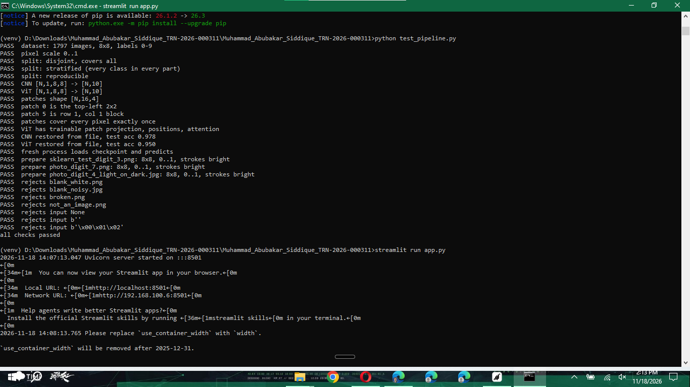
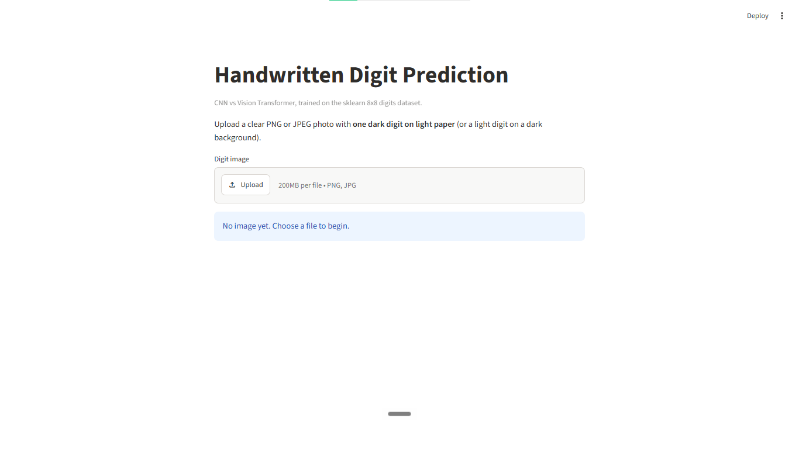
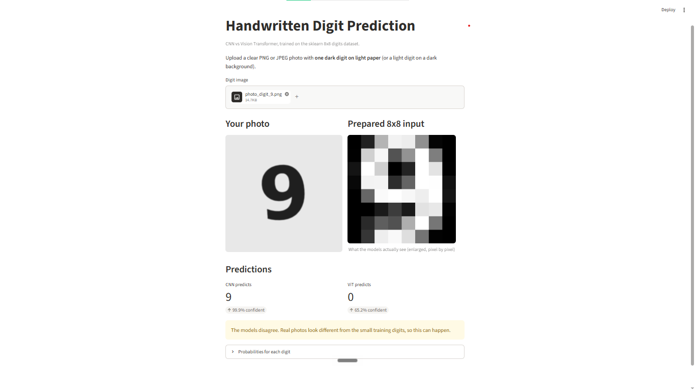

# Handwritten Digit Prediction (CNN vs Vision Transformer)

PSEB-FSB-01 | AI Engineering Bootcamp | Module 04 project
Muhammad Abubakar Siddique | TRN-2026-000311

## Run it

```
pip install torch scikit-learn streamlit pillow numpy matplotlib
streamlit run app.py
```

The trained weights are already in `models/`, so the app works straight away.
No training happens inside the app. To retrain and regenerate every result:

```
python train.py          # about a minute on a laptop CPU
python test_pipeline.py  # sanity checks for the rubric items
python make_samples.py   # rebuilds the demo images in samples/
```

## Screenshots

Tests and app start-up in the terminal (Windows, Python venv):



The app before anything is uploaded:



A prediction. The prepared 8x8 input is shown next to both model outputs. On this
particular image the CNN says 9 and the ViT says 0, so the app shows its
disagreement warning. This is a real example of the ViT being weaker than the CNN on
photo-style input.



## Files

| File | What it does |
|---|---|
| `common.py` | Data loading, the one shared split, CNN, ViT, save/load |
| `preprocess.py` | Photo to 8x8 preparation, input checks |
| `train.py` | Trains both models, evaluates, saves weights and results |
| `app.py` | Streamlit app |
| `models/cnn.pt`, `models/vit.pt` | Saved weights plus constructor settings |
| `models/settings.json` | Shared settings (scale, patch size, classes) |
| `results/` | `results.md`, `metrics.json`, confusion matrices, error examples, curves |
| `samples/` | Images to try in the app (clear digits, blank, broken) |
| `docs/screenshots/` | Screenshots used in this README |

## How it works

Data. `load_digits()`, 1797 images of 8x8, pixels 0 to 16, divided by 16 to get 0 to 1.
One stratified split (60/20/20, seed 42, indices saved in `results/split_indices.npz`)
is used for both models. Validation picks the best epoch. The test set is used once at the end.

CNN. Input `[N,1,8,8]`. Two Conv2d layers (16 and 32 filters), max pool, then a small
classifier. Output is 10 logits.

ViT. Input `[N,1,8,8]` is cut into 16 non-overlapping 2x2 patches, giving `[N,16,4]`.
A trainable linear layer projects each patch to 64 numbers, a learned position vector is
added, two Transformer encoder layers (4 attention heads) mix the patches, the patches are
averaged, and a linear layer gives 10 logits.

Photo preparation (`preprocess.py`). Open with Pillow, grayscale, make strokes bright on
dark (invert when the background is bright), find the strokes with an Otsu threshold,
crop to them, centre, area-average down to 8x8, divide by 255 to get 0 to 1.
Training pixels are 12/16 = 0.75 style values and upload pixels are 191/255 = 0.75 style
values, so both live in the same 0 to 1 range. The sklearn digits always touch the top and
bottom edge of the 8x8 grid, so the crop is scaled to do the same.

Rejected inputs: nothing uploaded, empty or unreadable file, wrong format, blank page
(no contrast or no stroke pixels), and images where no digit can be separated.

Saved and restored. Each checkpoint holds the weights and the settings needed to rebuild
the model. A fresh `streamlit run app.py` loads them and predicts, no retraining.

## Results (test set, 360 images)

| Model | Accuracy | Macro F1 |
|---|---|---|
| CNN | 0.9778 | 0.9777 |
| ViT | 0.9500 | 0.9496 |
| Majority baseline (always predicts 1) | 0.1000 | 0.0182 |

Both models are far above the baseline. The CNN wins here: with only 1077 training images
its built-in local filters help, while the ViT has to learn from scratch how patches relate.
Mistakes are on digits that look alike at 8x8: the CNN mixes up 1 and 4 and a few 8s, the
ViT mixes up 9 and 7, 8 and 1. Details are in `results/results.md`,
`results/confusion_matrices.png` and `results/errors.png`.

## Demo notes

Good demo image: `samples/sklearn_test_digit_3.png` or `samples/photo_digit_5.png`.
Rejected: `samples/blank_white.png`, `samples/broken.png`.

Real photos are harder than the training set. The training digits are tiny, clean and
all drawn in the same style. A phone photo has shadows, thin pens, tilt and background
texture, so the 8x8 version can look different and the models can disagree or be wrong.
Matching the pixel scale does not fix that. Use a thick dark pen on plain paper with
even light.
